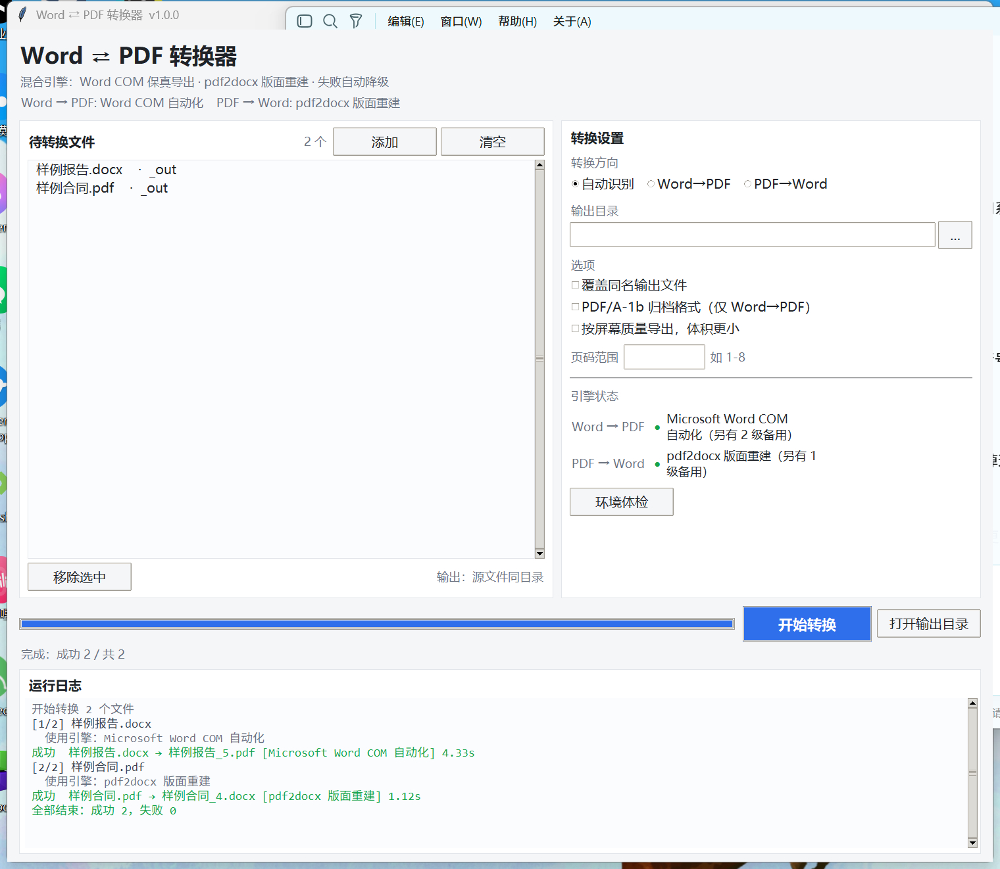

# Word ⇄ PDF 转换器（wordpdf）

一个 Windows 桌面插件，做 **Word → PDF** 和 **PDF → Word** 双向转换。
支持图形界面（拖拽）、命令行、以及在 Word 里通过 VBA 宏直接调用。



**30 秒上手**：克隆仓库 → 双击 `启动转换器.bat`（首次自动建环境并装依赖）→ 拖文件进窗口。

```bash
git clone https://github.com/<你的账号>/wordpdf.git
cd wordpdf
```

> 只支持 Windows（Word COM 是 Windows 专有）。macOS / Linux 会走 LibreOffice 或纯 Python 兜底链路。

---

## 一、这个插件是用什么方式实现的？

**一句话：混合引擎 + 自动降级。核心不是"自己写格式解析器"，而是编排本机已有的转换能力。**

| 方向 | 首选方案 | 实现原理 | 为什么选它 |
|------|----------|----------|-----------|
| Word → PDF | **Microsoft Word COM 自动化** | 用 `pywin32` 启动一个隐藏的 Word 进程，打开文档后调用 Word 自己的 `Document.ExportAsFixedFormat` 导出 PDF | 用的是微软官方的 PDF 导出引擎，**字体、分页、页眉页脚、目录、批注与原文 1:1 一致**，不存在"排版走样" |
| PDF → Word | **pdf2docx（版面重建）** | PyMuPDF 逐页解析出文本块、图片、表格线段的**坐标**，再按坐标反推段落/表格结构，用 python-docx 重新生成 docx | PDF 里没有"段落/表格"这些语义，只有绘制指令，只能靠版面分析反推；pdf2docx 是目前纯 Python 方案里表格识别最靠谱的 |

关键点：**两条路都不是"读文本再重写"**。Word→PDF 是调真 Word 渲染；PDF→Word 是做几何反推。

### 为什么不用"纯 Python 自己画 PDF"当主力？

因为那需要自己实现行距、分页、表格、图片、字体嵌入、断行规则……做出来的东西永远和 Word 排版不一样。所以它只作为**第三级兜底**存在（见下）。

### 降级链（核心机制）

```
Word → PDF
  ①Microsoft Word COM  ──失败/未安装──▶  ②LibreOffice 无头  ──失败/未安装──▶  ③纯 Python 重排
     （1:1 保真）                          （soffice --convert-to）           （PyMuPDF 自己画页面）

PDF → Word
  ①pdf2docx 版面重建   ──失败/未安装──▶  ②PyMuPDF 纯文本流（只保证文字不丢）
```

- 每一级转换前都会 **探测本机是否具备条件**（注册表找 WINWORD.EXE、`shutil.which` 找 soffice、检查模块是否可导入）。
- 前一级抛异常 → 自动落到下一级，界面/日志会标注「已降级」，最终结果里带 `attempts` 记录每一级的失败原因。
- 用户也可以用 `--engine` 强制指定某一级，或灌入自定义引擎（`core/converter.py` 里的 `ENGINES` 字典）。

### 三层架构

```
┌──────────────────────────── 界面层 ────────────────────────────┐
│  gui.py（Tkinter，拖拽/批量/进度/日志）   cli.py（python -m wordpdf）│
│  addin/WordPdfAddin.bas（Word 宏，Alt+F8 直接调）                 │
└───────────────────────────────┬────────────────────────────────┘
                                │ 统一的 convert_file / convert_many
┌───────────────────────────────▼────────────────────────────────┐
│  编排层 converter.py：判定方向 → 定输出路径 → 按降级链试引擎       │
├────────────────────────────────────────────────────────────────┤
│  引擎层                                                          │
│   docx2pdf.py        WordComEngine / LibreOfficeEngine /        │
│                      PythonRendererEngine                       │
│   pdf2docx_engines.py Pdf2DocxEngine / TextFlowEngine           │
│   render_docx.py     纯 Python 排版（读 docx → 画 PDF）           │
├────────────────────────────────────────────────────────────────┤
│  支撑层 discovery.py（探测环境） fonts.py（字体解析/子集化）        │
│         model.py（Options / ConversionResult）                   │
└────────────────────────────────────────────────────────────────┘
```

---

## 二、目录结构

```
pul/
├─ wordpdf/
│  ├─ core/
│  │  ├─ converter.py        编排 + 降级链（ENGINES 在这里注册）
│  │  ├─ docx2pdf.py         Word→PDF 三个引擎
│  │  ├─ pdf2docx_engines.py PDF→Word 两个引擎
│  │  ├─ render_docx.py      纯 Python 排版引擎（分页/表格/图片/换行禁则）
│  │  ├─ discovery.py        环境探测（Word / LibreOffice / 依赖模块）
│  │  ├─ fonts.py            系统字体解析、字体子集化
│  │  ├─ base.py             引擎基类
│  │  └─ model.py            选项与结果数据类
│  ├─ gui.py                 Tkinter 界面
│  ├─ cli.py                 命令行
│  └─ addin/WordPdfAddin.bas Word 加载项（VBA）
├─ tests/
│  ├─ selftest.py            端到端自检（造样例 → 双向转换 → 校验产物）
│  └─ gui_smoke.py           界面冒烟测试（自动点一次转换并截图）
├─ 启动转换器.bat            双击启动 GUI（首次自动建环境）
├─ run_gui.pyw               无控制台启动脚本（带异常捕获）
├─ requirements.txt / pyproject.toml
├─ docs/screenshot.png       界面截图
├─ .gitignore / LICENSE
```

---

## 三、安装

```bash
python -m venv .venv
.venv\Scripts\python.exe -m pip install -r requirements.txt
```
国内网络慢可加 `-i https://pypi.tuna.tsinghua.edu.cn/simple`。

> 注意：GUI 依赖 `tkinter`。python.org 的官方安装包自带；某些精简版/嵌入式 Python 不带，
> 这类环境仍可用命令行，但界面会报 `No module named tkinter`。

---

## 四、使用

### 1. 图形界面
双击 `启动转换器.bat`（首次会自建虚拟环境），或 `python -m wordpdf.gui`。

- 拖文件进窗口（需 `tkinterdnd2`）或点「添加」
- 选方向（默认自动识别后缀）、输出目录、是否覆盖
- 右侧「引擎状态」实时显示本机哪条链路可用；点「环境体检」看详细探测结果

### 2. 命令行
```bash
python -m wordpdf --info                     # 体检本机与各引擎可用性
python -m wordpdf 报告.docx                  # Word → PDF（同目录）
python -m wordpdf 合同.pdf -o D:\out         # PDF → Word
python -m wordpdf *.docx --to pdf --screen   # 批量，屏幕质量（体积更小）
python -m wordpdf 手册.pdf --pages 1-10      # 只转前 10 页
python -m wordpdf 归档.docx --pdfa           # 输出 PDF/A-1b
python -m wordpdf 某文件.docx --engine word-com   # 强制指定引擎
```

### 3. 在 Word 里用
1. Word 中 `Alt+F11` 打开 VBA 编辑器 → 文件 → 导入文件 → 选 `wordpdf/addin/WordPdfAddin.bas`
2. 改模块顶部 `PROJECT_DIR` / `PY_EXE` 为你的实际路径
3. `Alt+F8` 可见四个宏：

| 宏 | 作用 |
|----|------|
| `WC_ExportCurrentToPDF` | 当前文档导出 PDF |
| `WC_ConvertPDFToWord` | 选若干 PDF 批量转 Word |
| `WC_ConvertFolder` | 整个文件夹的 doc/docx 批量转 PDF |
| `WC_OpenConverter` | 打开图形界面 |

想放到工具栏：文件 → 选项 → 快速访问工具栏 → 从「宏」中添加。

### 4. 作为库调用
```python
from wordpdf.core import convert_file, Options

res = convert_file("报告.docx", "报告.pdf", options=Options(overwrite=True))
print(res.ok, res.engine, res.elapsed, res.message)
```

---

## 五、各自的能力边界（说清楚，免得踩坑）

| 场景 | 表现 |
|------|------|
| 装 Word 的机器，Word→PDF | 与"另存为 PDF"完全一致，包括域、页眉页脚、目录、批注、书签 |
| 没装 Word，有 LibreOffice | 基本一致，复杂域/宏/特殊字体可能轻微走样 |
| 都没有 | 纯 Python 兜底：正文/标题/列表/表格/图片都在，但**只保证内容和层次，不保证分页与 Word 一致** |
| 文字版 PDF→Word | pdf2docx 可还原段落、表格、图片位置；扫描件不行（见下） |
| 扫描件/图片型 PDF | **不支持 OCR**，转出来只有图片。需要先走 OCR（如 PaddleOCR / 微软 OCR）再转 |
| 加密 PDF | 打开即报错，需先解密 |
| PDF 里的复杂元素 | 多栏排版、公式、艺术字、矢量图表还原有限——这是 PDF 格式本身决定的 |

**为什么 PDF→Word 天生是有损的**：PDF 是"把字画在某个坐标上"的绘图指令流，不含段落、表格、样式语义。
转 Word 必须靠版面分析去猜：猜哪里是段落、哪里是表格、哪里是两栏。猜错就会重排。
所以「PDF 转 Word 百分百还原」在技术上不存在，只有还原度高低之分。

---

## 六、实现细节备忘

- **COM 隔离**：用 `DispatchEx` 起独立 Word 进程，转换完 `Quit`，不会干扰用户已经打开的文档；先 `CoInitialize` 再调用，线程安全。
- **导出参数**：`ExportFormat=17`（PDF）、`OptimizeFor`（0 打印 / 1 屏幕）、`CreateBookmarks=1`（标题转书签）、`UseISO19005_1`（PDF/A）。
- **字体**：纯 Python 引擎优先嵌入系统 TrueType（等线 → 宋体 → 雅黑），因为 PyMuPDF 内置的 `china-s` 会把 ASCII 按全角宽度渲染（"12.8" 变成 "1 2 . 8"）。
- **字体子集化**：`doc.subset_fonts()`，否则一份 PDF 会从 150KB 涨到 23MB。
- **中文换行禁则**：标点不出现在行首（遇到时把前一个字一起挪到下一行）。
- **输出命名**：默认同目录同名换后缀；已存在且未开启覆盖时自动加 `_1`、`_2`。
- **界面 DPI**：先 `SetProcessDpiAwareness(2)` 再建窗口，否则 150% 缩放下窗口会被裁切。

## 七、常见问题

### 双击 `启动转换器.bat` 一闪而过
已经修好（v1.0.1），原因是旧版批处理用 **Unix 的 LF 换行**保存，cmd.exe 解析时会
把 `python` 截成 `ython`，直接报「不是内部或外部命令」然后退出，窗口一闪就没。

现在这个 bat 是 **CRLF 换行 + GBK 编码**（中文在 cp936 的 cmd 里才不会乱码），并且：

- 所有失败分支都会 `pause` 停住，让你看清报什么错；
- 界面进程用 `run_gui.pyw` 启动，**任何异常都会弹窗 + 写日志**，不会静默消失；
- 启动前先检查 `.venv` 里的 tkinter / python-docx 是否完整，缺了会提示重建。

还是打不开时，按顺序排查：

| 现象 | 处理 |
|------|------|
| 黑窗口一行红字后消失 | 用 `启动转换器.bat /debug` 运行（会保留控制台并打印完整堆栈） |
| 弹窗说 `No module named tkinter` | 你的 Python 不带 tkinter。删掉 `.venv`，用 python.org 官方安装包装一遍再双击 |
| 弹窗说缺少 `docx` / `pymupdf` | 删掉 `.venv` 重新双击，让它自动装依赖（走清华镜像） |
| 完全没有反应 | 右键 → 编辑，确认第 7-8 行的 `.venv\Scripts\pythonw.exe` 路径存在 |
| 想看启动日志 | 看 `logs\startup.log`（崩溃堆栈）与 `logs\stdout.log`（第三方库输出） |

> 检查 bat 的换行是否正常：`file 启动转换器.bat` 应显示 `ASCII text, with CRLF line terminators`。

### 转换报「未找到引擎」
先跑 `python -m wordpdf --info`，看三条链路哪条可用。Word→PDF 至少需要
Word（COM）或 LibreOffice 之一，或退回纯 Python 引擎；PDF→Word 至少要能导入 pdf2docx。

## 八、自检

```bash
.venv\Scripts\python.exe tests\selftest.py    # 造样例 → 双向转换 → 校验产物
.venv\Scripts\python.exe tests\gui_smoke.py   # 界面冒烟（需要桌面环境）
```

`selftest.py` 会打印本机环境、各引擎链路，以及每种转换的耗时、页数、文字层校验结果。

## 九、打包成 exe（可选）

```bash
pip install pyinstaller
pyinstaller -w -n WordPdfTool --add-data "wordpdf;wordpdf" --hidden-import pythoncom ^
  --hidden-import win32com.client --hidden-import win32com.gen_py -m wordpdf.gui
```
打包后若在客户机上运行 PDF→Word，pdf2docx 的依赖（opencv-headless）体积较大，属正常现象。

---

## 十、发布到 GitHub

### 只传 `启动转换器.bat` 能跑吗？

**不能。** 那个 bat 只负责"找 Python → 建虚拟环境 → 装依赖 → 启动界面"，
真正的转换逻辑在 `wordpdf/` 包里，bat 里一行 Python 都没有。
只传 bat 的话，别人双击后会在 `pip install` 那步失败，因为找不到 `requirements.txt` 和源码。

### 应该提交的（大约 20 个文件，不到 200 KB）

```
wordpdf/                  整个包：core/ 引擎与编排、gui.py、cli.py、addin/*.bas
run_gui.pyw               启动器
启动转换器.bat              一键启动脚本
requirements.txt          依赖清单
pyproject.toml            可 pip install -e . / 命令行入口
README.md  LICENSE  .gitignore
docs/screenshot.png       README 里引用的截图
tests/                    selftest.py、gui_smoke.py（可选，但建议留，别人能自检）
```

### 千万不要提交的

| 排除项 | 原因 |
|--------|------|
| `.venv/` | 虚拟环境有绝对路径 + 上百 MB 二进制，且平台绑定，必须由使用者本地生成 |
| `__pycache__/` `*.pyc` | 编译缓存，无用 |
| `logs/`、`tests/_out/` | 运行产物、测试中间文件 |
| `*.egg-info/` `build/` `dist/` | 打包中间产物 |
| 你自己的 `.env`、个人绝对路径 | 泄露信息 |

`.gitignore` 里已经排好了，`git add .` 不会误传。

### 提交并推送

```bash
git init
git add .
git status --short          # 先确认一遍清单，不该出现的文件在这里能看见
git commit -m "feat: Word ⇄ PDF 双向转换插件（混合引擎 + 自动降级）"
git branch -M main
git remote add origin https://github.com/<你的账号>/wordpdf.git
git push -u origin main
```

### 发布前的三个自查

1. `LICENSE` 里的 `Copyright (c) 2026 wordpdf contributors` 改成你的名字或 GitHub 昵称（用 MIT 就够，想更严格可换 Apache-2.0）。
2. `wordpdf/addin/WordPdfAddin.bas` 顶部两行是占位路径 `C:\path\to\wordpdf`，**不要**把自己的本机路径提交上去。
3. 用干净目录验证一遍：`git clone` 到别处 → 双击 `启动转换器.bat`，能自动建环境并弹出界面才算发布合格
   （首次会跑 `pip install`，1–3 分钟属正常）。

> 建议给仓库加 topics：`word-to-pdf` `pdf-to-word` `docx` `pdf` `python` `tkinter`，
> 并在 About 里写明「Windows only，基于 Word COM + pdf2docx」。

